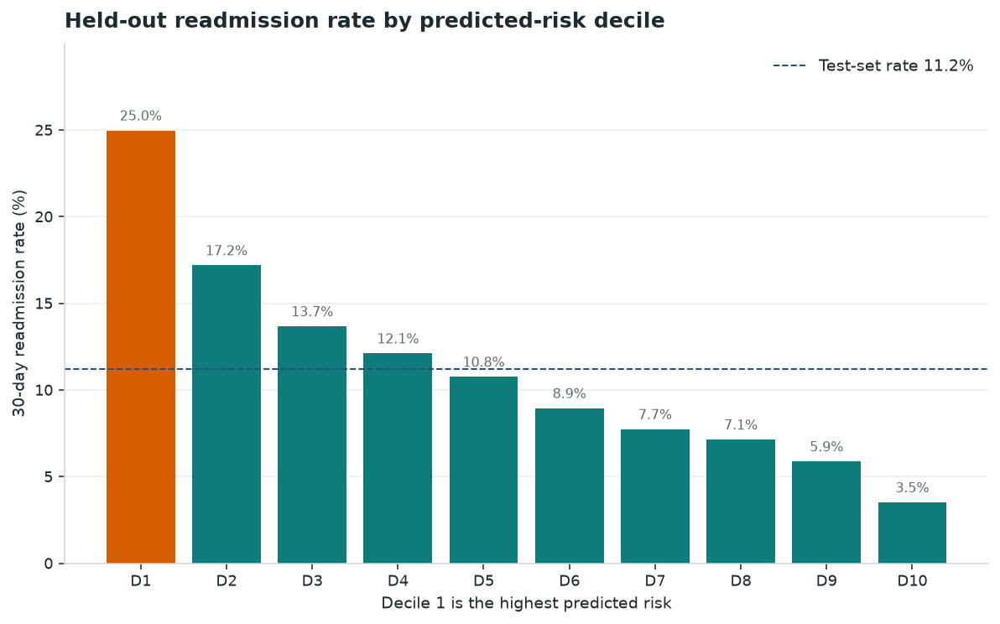
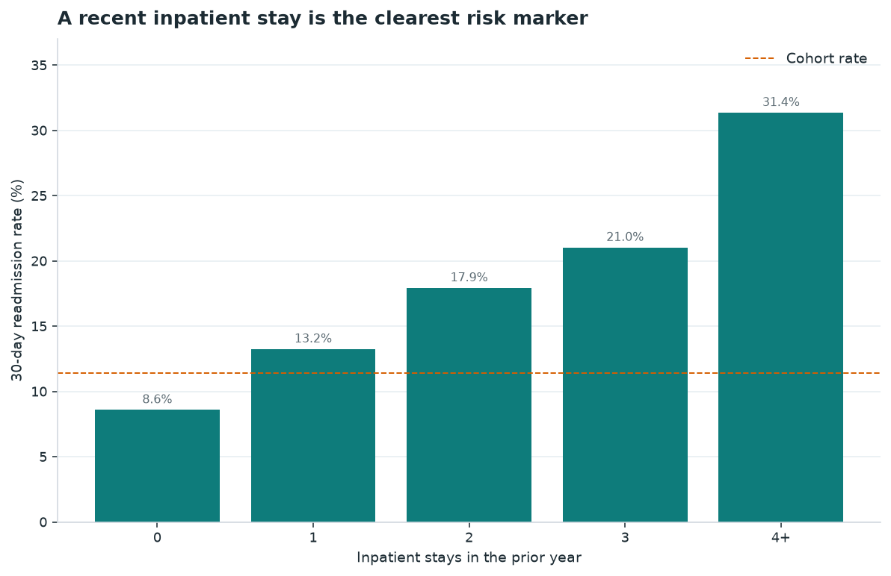
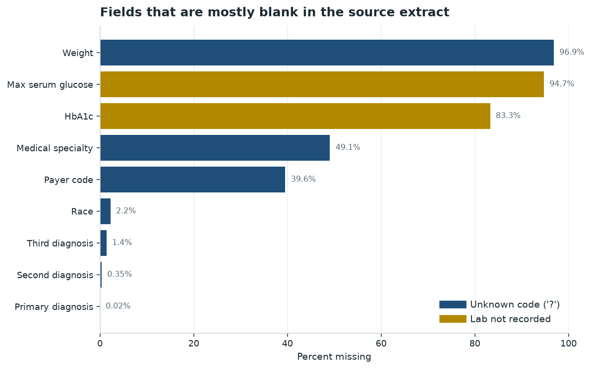
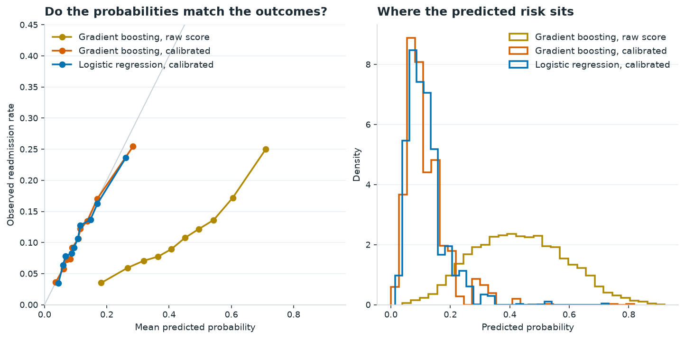
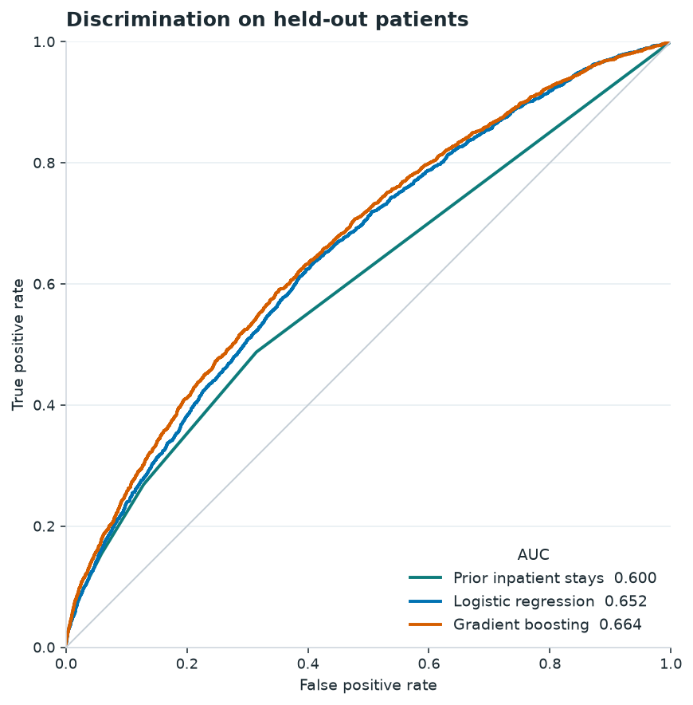
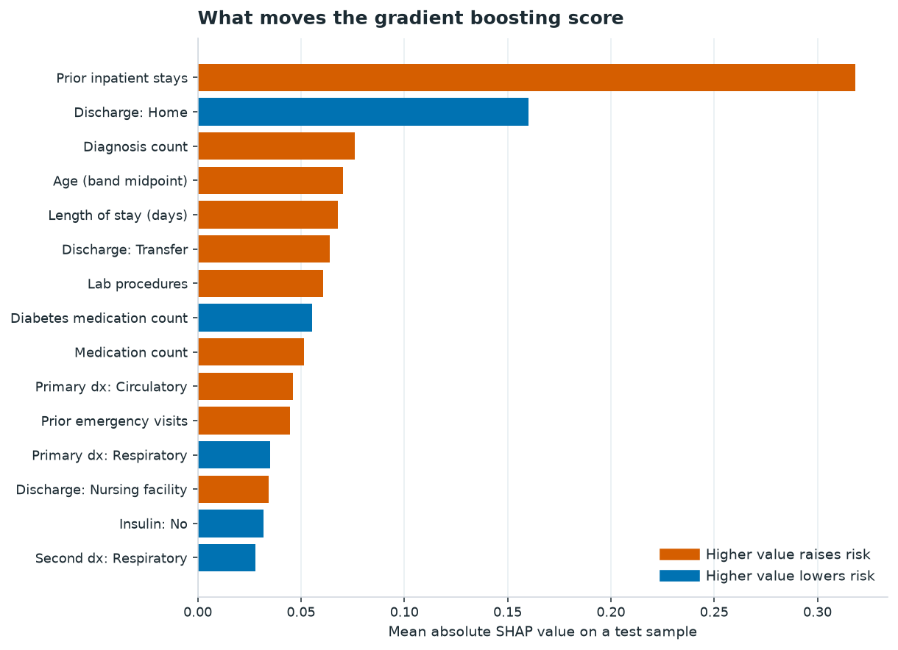
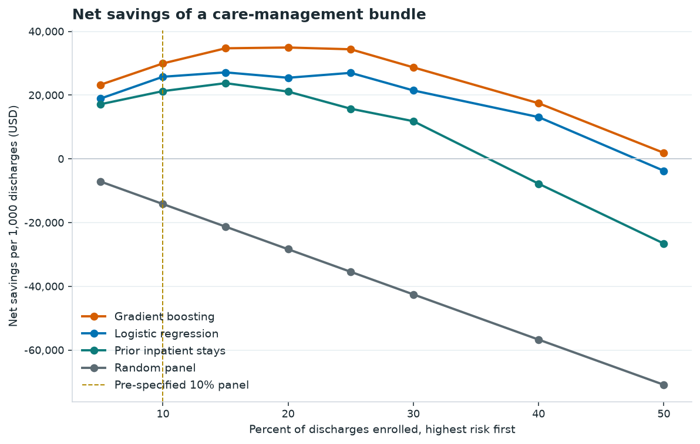
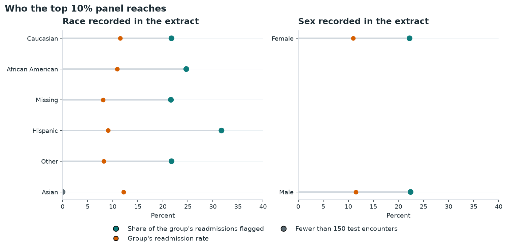

# 30-day hospital readmission risk

**Tanner Allred · Houston, TX**

A discharge-time model that ranks which diabetic inpatients are most likely to be readmitted within 30 days, and a costed case for spending a care-management budget on the top of that list.

The work uses the public [UCI Diabetes 130-US hospitals (1999–2008)](https://archive.ics.uci.edu/dataset/296/diabetes+130-us+hospitals+for+years+1999-2008) extract: 101,766 de-identified encounters from 130 hospitals. The file is downloaded by script and is not stored in git. Every number below comes from `reports/metrics.json` produced by `python scripts/run_analysis.py`.

## The decision

At discharge, a care-management team can enroll only a fraction of patients. The useful question is not “will this person be readmitted?” at a 50% cutoff. The base rate is about 11%, and a well-ranked list is worth more than a single yes/no. This analysis asks:

1. Can the record available at discharge concentrate 30-day readmissions into a small panel?
2. Under stated cost assumptions, does enrolling the highest-risk 10% pay for a post-discharge bundle?
3. Does that panel reach demographic groups at similar rates?

The target is binary: `readmitted = '<30'` versus `'>30'` or `'NO'`. A readmission after 30 days is not counted as an event.

## Result

On **13,997 held-out patients** (19,894 encounters, 11.2% readmitted within 30 days):

| Model | Test AUC (patient-clustered 95% interval) | Average precision | Top 10% precision | Top 10% recall | Net per 1,000 discharges |
| --- | ---: | ---: | ---: | ---: | ---: |
| Random panel | 0.50 | 0.112 | 11.2% | 10.0% | −$14,175 |
| Prior inpatient stays only | 0.600 | 0.171 | 22.3% | 19.9% | $21,268 |
| Logistic regression | 0.652 (0.639–0.664) | 0.201 | 23.7% | 21.1% | $25,772 |
| Gradient boosting | **0.664 (0.651–0.678)** | **0.218** | **25.0%** | **22.3%** | **$29,954** |

Five-fold GroupKFold on the development patients, with encoders refit inside each fold, gave an out-of-fold AUC of **0.672** for gradient boosting (fold SD 0.003) and **0.663** for logistic regression. The test result sits close to that estimate.

The top 10% panel was fixed before looking at the test set. Gradient boosting places **497 of 2,227** test-set readmissions into **1,989** discharges (lift **2.23×** the 11.2% base rate). The lowest decile readmits at **3.5%**.

Most of that concentration is already in one field: inpatient stays in the prior year. The full model still captures **54 more** readmissions than ranking on that field alone, in the same size panel. Under the assumptions below, that is about **$8,700 more net per 1,000 discharges** than the utilization rule, and about **$4,200 more** than the logistic regression.



## What the cohort shows

Raw file: **101,766 encounters, 71,518 patients**. The analysis cohort drops 2,426 encounters discharged expired, to hospice, or still in the hospital, and 3 encounters with unknown sex. That leaves **99,337 encounters, 69,985 patients, 11,312 thirty-day readmissions (11.4%)**.

Weight is missing on 96.9% of rows and payer code on 39.6%, so both are dropped. Medical specialty is missing on 49.1% and is kept, with an explicit Missing level; rare specialties are collapsed using the training split only. HbA1c is absent on 83.3% of rows and max serum glucose on 94.7%. Those blanks mean the test was not recorded, so they are categories in the model, not rows thrown away. Race is missing on 2.2%. ICD-9 codes are grouped with the clinical map from Strack et al. (circulatory 390–459 and 785, diabetes 250.xx, and the other standard chapters).



Patients with no prior inpatient stay are readmitted **8.6%** of the time. Patients with four or more are readmitted **31.4%** of the time. One or more prior inpatient stays: **17.0%**, versus **8.6%** with none (`sql/cohort_queries.sql`, query `high_utilizer_gap`).

Age is not a straight line. The 20–29 band is the highest, at **14.3%**, the 50–59 band is the lowest adult band at **9.8%**, and the rate is **12.6%** at 80–89. Stays with a recorded HbA1c run about **9.8–10.2%**, against **11.7%** when it was not measured. That is a raw association, not an estimate of the effect of ordering the test. Primary diabetes is **13.1%** (n = 8,661). Circulatory disease is the volume group (n = 29,679) at **11.7%**, near the cohort rate.



## Model

**Prediction point.** Scores use only information known at discharge: demographics allowed into the model (age band), admission and discharge disposition, utilization in the prior year, in-stay intensity (length of stay, labs, procedures, medications), grouped ICD-9 diagnoses, HbA1c and glucose categories, and diabetes-medication pattern. Race and sex are **not** features. They are used only in the audit.

**Class imbalance.** About 11% of encounters are positive. Logistic regression uses `class_weight='balanced'`. Gradient boosting (LightGBM, 250 trees, learning rate 0.05, hyperparameters fixed in `src/readmission/config.py`) uses `scale_pos_weight`. Those settings improve ranking and push the raw scores away from the base rate, so the raw score is not treated as a probability.

**Validation.** Patients are split 60% fit / 20% calibration / 20% test, stratified on whether the patient has any 30-day readmission. The same patient is never in two sets. Isotonic regression is fit on the calibration patients. Discrimination (AUC, average precision, the top 10% ranking) uses the raw score. Brier score and the reliability curve use the calibrated probabilities. The reported AUC interval resamples **patients**, not encounters.

**Calibration.** After isotonic regression, gradient boosting has a Brier score of **0.095** against **0.099** for a constant prediction at the test-set base rate, and an expected calibration error of **0.006**. The gold curve below is the raw, class-weighted score; it ranks well and is not a probability.





## What moves the score

SHAP is computed on a seeded sample of 2,000 held-out encounters, on the uncalibrated gradient boosting model. Prior inpatient stays dominate. Discharge home pulls risk down (home discharges in the cohort readmit at 9.3%; transfers readmit at 22.1%). More recorded diagnoses, older age, a longer stay, and prior emergency visits push risk up. These are associations inside the model, not effects of changing a discharge plan or a medication.



## What the panel is worth

Planning assumptions, set in `src/readmission/config.py` before the test run and repeated as editable inputs in `reports/business_case.xlsx`:

| Assumption | Value | Role |
| --- | ---: | --- |
| Cost of one 30-day readmission | $16,000 | Gross savings if a readmission is avoided |
| Cost of the post-discharge bundle | $500 | Charged for every enrolled discharge |
| Relative reduction among people who get the bundle | 20% | Applied to observed readmissions in the panel |

The break-even precision at these inputs is **15.6%** (`$500 / (0.20 × $16,000)`). A random 10% panel, at the 11.2% base rate, loses money. Every ranked policy above clears 15.6%.

The test-set arithmetic for the pre-specified top 10%, using observed readmissions in the panel:

| Policy | Readmissions in the panel | Precision | Recall | Readmissions avoided (at 20%) | Net on the test set | Net per 1,000 discharges |
| --- | ---: | ---: | ---: | ---: | ---: | ---: |
| Random | 223 expected | 11.2% | 10.0% | 44.5 | −$282,000 | −$14,175 |
| Prior inpatient stays | 443 | 22.3% | 19.9% | 88.6 | $423,100 | $21,268 |
| Logistic regression | 471 | 23.7% | 21.1% | 94.2 | $512,700 | $25,772 |
| Gradient boosting | 497 | 25.0% | 22.3% | 99.4 | $595,900 | $29,954 |

At the gradient boosting precision of 25.0%, the bundle breaks even up to about **$800** per enrolled discharge if the readmission cost and the 20% reduction stay put. The Excel sheet `Calculator` recomputes the dollars from the test-set counts when those three inputs change.

A second capacity was chosen on the **calibration** patients by maximizing net savings, then scored once on the test patients. That capacity is **15%**. On the test set it catches 682 readmissions (precision 22.9%, recall 30.6%) and produces **$34,704** net per 1,000 discharges. The 10% figure above is the pre-specified headline; 15% is the sensitivity check, and it is the better capacity under these costs.



This is not an estimate of a real program’s effect. The 20% reduction is an assumption applied evenly across the risk list. People at the very top of the list may be harder to influence, and this file has no intervention arm.

## Fairness and HIPAA

Race and sex never enter the model. The audit asks whether the **same global top 10% rule** flags a similar share of each group’s readmissions on the test set.

| Group | Test encounters | Readmission rate | Share of the group flagged | Recall within the group |
| --- | ---: | ---: | ---: | ---: |
| Female | 10,946 | 10.9% | 10.2% | 22.2% |
| Male | 8,948 | 11.5% | 9.8% | 22.4% |
| Caucasian | 14,910 | 11.5% | 9.7% | 21.7% |
| African American | 3,688 | 10.9% | 11.4% | 24.7% |
| Hispanic | 452 | 9.1% | 11.7% | 31.7% |
| Other | 280 | 8.2% | 10.0% | 21.7% |
| Missing race | 457 | 8.1% | 6.8% | 21.6% |
| Asian | 107 | 12.1% | 2.8% | 0% (unstable) |

Sex-specific recall differs by **0.2 percentage points**. Among race groups with at least 150 test encounters, recall runs from **21.7%** (Caucasian) to **31.7%** (Hispanic). The Hispanic estimate is based on about 41 readmissions, so a 10-point gap is a monitoring flag, not a stable disparity. Asian encounters in the test set (n = 107) are under that 150-encounter line; a recall of zero there is not interpretable. Age **is** a feature. The rule flags **42%** of readmissions among adults under 40 and **19%** among adults 80 and older, with selection rates of 14.7% and 9.4%. Older adults are a much larger share of the discharges. These figures describe the policy. They do not certify the score for deployment.



**Handling of the file.** The UCI release is already de-identified: no names, addresses, exact dates, or medical-record numbers. Age is in 10-year bands. `encounter_id` and `patient_nbr` are anonymous keys. This project does not attempt re-identification. `scripts/download_data.py` checks the zip against a pinned SHA-256, writes it under `data/raw/`, and that directory is gitignored. Charts and tables are aggregates. De-identified research data is still sensitive health information and stays in the analysis environment. Nothing here is a bedside tool or a substitute for a hospital’s own validation.

## How to run

```bash
python -m venv .venv
source .venv/bin/activate
pip install -r requirements.txt
python scripts/download_data.py
python scripts/run_analysis.py
pytest
```

`scripts/run_analysis.py` writes:

- `reports/metrics.json` — the numbers in this README
- `reports/figures/` — the charts
- `reports/tables/` — SQL summaries, deciles, scenarios, and the fairness audit (Power BI or Excel import tables)
- `reports/business_case.xlsx` — snapshot plus a Calculator sheet whose dollar cells are formulas

The walkthrough with saved outputs is `notebooks/readmission_analysis.ipynb`. Re-execute it with:

```bash
jupyter nbconvert --to notebook --execute notebooks/readmission_analysis.ipynb --inplace
```

## Layout

```
src/readmission/          cohort rules, DuckDB runner, models, costs, charts
sql/cohort_queries.sql    named cohort queries (overview, age, ICD-9 group, utilization)
scripts/download_data.py  pinned download of the UCI zip
scripts/run_analysis.py   end-to-end run
notebooks/                executed walkthrough
reports/                  figures, tables, metrics, workbook
tests/                    cohort rules, SQL, split leakage, cost math, a tiny model fit
```

## Skills this project is meant to show

- **Healthcare analytics.** A discharge-time risk set, ICD-9 grouping, disposition codes, and a 30-day outcome defined the way operations staff use it.
- **Python modeling.** pandas, scikit-learn logistic regression, LightGBM, isotonic calibration, SHAP.
- **Validation.** Patient-level splits, grouped cross-validation, a calibration holdout, and a patient-clustered AUC interval.
- **SQL.** The cohort questions live in `sql/cohort_queries.sql` and run in DuckDB, including a utilization CTE.
- **Decision math.** Deciles, lift, a break-even precision, and an Excel calculator a finance partner can edit. The decile table is the same object as a tiered insurance book: how much of the outcome sits in the top score band, and how far down the list the budget should go.
- **Measurement limits.** Class imbalance, calibration versus ranking, a fairness audit with protected attributes held out of the fit, and an explicit HIPAA note on a de-identified file.

## Limits

- The encounters are from **1999–2008**, coded in ICD-9, before the Hospital Readmissions Reduction Program. Case mix, documentation, and penalties have changed.
- The public file has **no dates**, so the split is by patient rather than a prospective year.
- An AUC of 0.66 ranks a panel. It does not support telling an individual patient that a readmission will happen.
- The dollar result moves one-for-one with the assumed readmission cost, bundle cost, and relative reduction. Change them in the workbook before treating the savings as a plan.
- Specialty is missing on half the rows. Hospital identity is not in the file, so the model cannot learn site effects.
- Patients can have more than one encounter. The split keeps a person on one side, and the AUC interval resamples people, because those encounters are not independent.

## Citation

Beata Strack, Jonathan P. DeShazo, Chris Gennings, Juan L. Olmo, Sebastian Ventura, Krzysztof J. Cios, and John N. Clore, “Impact of HbA1c Measurement on Hospital Readmission Rates: Analysis of 70,000 Clinical Database Patient Records,” *BioMed Research International*, 2014. UCI Machine Learning Repository, Diabetes 130-US Hospitals for Years 1999–2008, [DOI 10.24432/C5230J](https://doi.org/10.24432/C5230J), CC BY 4.0.

Zip used here: `https://archive.ics.uci.edu/ml/machine-learning-databases/00296/dataset_diabetes.zip`  
SHA-256: `66d9820c3bd5fd2abf7957bda2d9714b2de1e7bba1ac1f1ff8fa85e83c22cb33`
